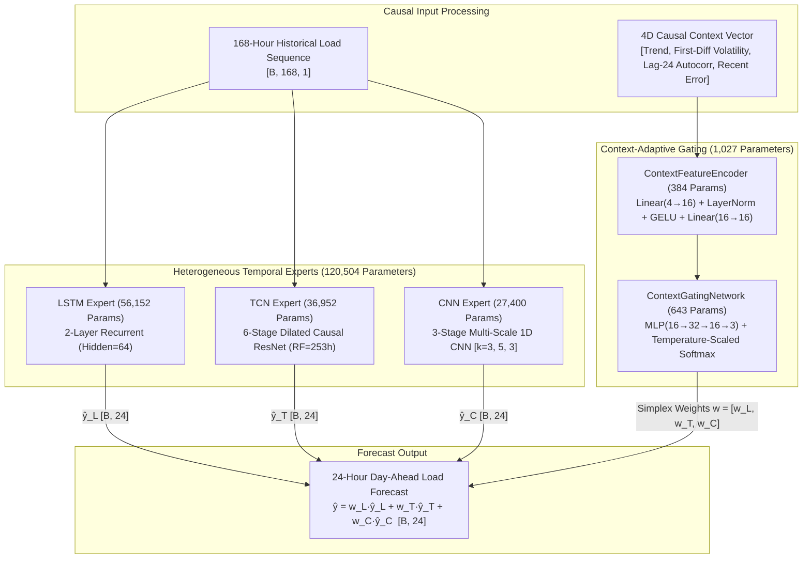

# CAEG-Net
### Context-Adaptive Expert Gating Network for Short-Term Electricity Load Forecasting

[](LICENSE)
[](requirements.txt)
[](requirements.txt)
[-success.svg)](caeg_net.py)

---

## Overview

**CAEG-Net** (Context-Adaptive Expert Gating Network; frozen benchmark architecture: **Canonical CAEG-Net V1**) is a neural mixture-of-experts architecture developed for short-term electricity load forecasting (STLF). Short-term load forecasting is a core operational requirement for power grid transmission operators, energy market clearinghouses, and dispatchers anticipating demand across a 24-hour day-ahead horizon.

Monolithic neural architectures face distinct structural trade-offs on univariate load series: recurrent networks (`LSTM`) capture smooth diurnal persistence; dilated causal convolutional networks (`TCN`) capture multi-scale temporal patterns across broad receptive fields; and localized convolutional networks (`CNN`) extract short-range ramp motifs. **Canonical CAEG-Net V1** coordinates these three heterogeneous temporal experts through a lightweight context-adaptive gating network (`1,027` routing parameters) conditioned on a 4-dimensional causal physical context vector extracted strictly from the 168-hour historical lookback window.

---

## Research Question

> **Can a lightweight, context-aware adaptive gating mechanism coordinating heterogeneous temporal neural experts (LSTM, TCN, CNN)—conditioned strictly on causal historical sequence statistics—improve day-ahead forecasting accuracy over standalone experts and static equal-weight ensemble fusion across diverse electrical power grids?**

---

## Architecture (Canonical CAEG-Net V1)

Canonical CAEG-Net V1 (`caeg_net.py`, **121,531 trainable parameters**) maps a 168-hour historical sequence of univariate electricity demand observations and its 4-dimensional causal context vector into a 24-hour day-ahead load forecast.



### Tensor Flow
1. **168-Hour Historical Load** ($\mathbf{X}_t \in \mathbb{R}^{168 \times 1}$): Standardized using training-split parameters ($\mu_{\text{train}}, \sigma_{\text{train}}$) and passed in parallel to the three temporal expert backbones.
2. **4D Causal Context Vector** ($\mathbf{c}_t \in \mathbb{R}^4$): Computed strictly from historical observations without future leakage:
   - `c[0]` **Trend**: Ordinary least-squares linear slope fitted across the 168-hour lookback window.
   - `c[1]` **Volatility**: Standard deviation of first-order hourly differences $\text{std}(\Delta x_t)$ over the 168-hour lookback window.
   - `c[2]` **Daily Seasonality Strength**: Lag-24 autocorrelation across the 168-hour lookback window.
   - `c[3]` **Causal Recent Forecast Error**: Trailing 24-hour persistence proxy MAE (`mean(|x[-24:] - x[-48:-24]|)`), Z-score normalized using training-set context statistics.
3. **Expert Predictions**: Each expert outputs an independent 24-hour trajectory $\hat{\mathbf{y}}_L, \hat{\mathbf{y}}_T, \hat{\mathbf{y}}_C \in \mathbb{R}^{24}$.
4. **Horizon-Shared Softmax Gating**: `ContextFeatureEncoder` and `ContextGatingNetwork` map $\mathbf{c}_t$ to convex simplex weights $\mathbf{w}_t = [w_L, w_T, w_C]^\top$ ($w_k > 0, \sum_{k=1}^3 w_k = 1$) applied across the 24-hour forecast horizon:
   $$\hat{\mathbf{y}}_t = w_{t,L}\hat{\mathbf{y}}_{t,L} + w_{t,T}\hat{\mathbf{y}}_{t,T} + w_{t,C}\hat{\mathbf{y}}_{t,C}$$

---

## Model Specification

| Specification | Canonical CAEG-Net V1 Configuration |
| :--- | :--- |
| **Authoritative Implementation** | [`caeg_net.py`](caeg_net.py) (`CAEGNet`) |
| **Total Trainable Parameters** | **121,531** |
| **Expert Backbone Parameters** | **120,504** (`LSTMExpert`: 56,152; `TCNExpert`: 36,952; `CNNExpert`: 27,400) |
| **Context Routing Parameters** | **1,027** (`ContextFeatureEncoder`: 384; `ContextGatingNetwork`: 643) |
| **Input Lookback Window** | 168 Hours (7 contiguous days of hourly load) |
| **Forecast Horizon** | 24 Hours (day-ahead hourly profile) |
| **Causal Context Features (4D)** | `[Trend, First-Difference Volatility, Lag-24 Autocorrelation, Causal Recent Error]` |
| **Gating Mechanism** | Horizon-shared softmax simplex weights $\mathbf{w}_t \in \Delta^2$ (`[B, 3, 1]`) |
| **Evaluation Datasets** | Modern PJM (`MW`, 1,294 test windows), GEFCom2014 (`kW`, 10,944 test windows), UCI Cohort 320 (`MW`, 3,922 test windows) |
| **Evaluation Seeds** | 5 random initialization seeds `[42, 123, 999, 2024, 3407]` |

---

## Results

All metrics below are computed directly from the repository's verified multi-seed evaluation records and Phase 11 non-overlapping daily-block statistical tests.

### Table A — Main Forecasting Results (5-Seed Benchmarks)

Every model below was trained and evaluated across the same 5 initialization seeds (`[42, 123, 999, 2024, 3407]`) within each dataset cohort. Values report **Mean ± Sample SD ($s$, $\text{ddof}=1$)** across the 5 seeds.

| Dataset | Model | Parameters | MAE (mean ± SD) | RMSE (mean ± SD) | $R^2$ (mean ± SD) | Unit |
| :--- | :--- | ---: | ---: | ---: | ---: | :--- |
| **PJM** | **CAEG-Net V1** | 121,531 | **251.44 ± 9.74** | **334.32 ± 11.09** | **0.8723 ± 0.0086** | MW |
| PJM | Static Equal Fusion | 120,504 | 295.48 ± 15.54 | 404.24 ± 14.61 | 0.8133 ± 0.0138 | MW |
| PJM | TCN Expert (Best Standalone) | 36,952 | 259.86 ± 8.54 | 351.37 ± 11.19 | 0.8590 ± 0.0091 | MW |
| PJM | LSTM Expert | 56,152 | 301.45 ± 19.17 | 414.81 ± 21.86 | 0.8032 ± 0.0203 | MW |
| PJM | CNN Expert | 27,400 | 469.53 ± 58.34 | 628.85 ± 61.63 | 0.5452 ± 0.0882 | MW |
| **GEFCom2014** | **CAEG-Net V1** | 121,531 | 12.55 ± 0.13 | 18.28 ± 0.17 | 0.8573 ± 0.0026 | kW |
| GEFCom2014 | Static Equal Fusion | 120,504 | 12.53 ± 0.11 | 18.08 ± 0.14 | 0.8604 ± 0.0021 | kW |
| GEFCom2014 | **TCN Expert (Best Standalone)** | 36,952 | **12.40 ± 0.12** | **18.02 ± 0.12** | **0.8613 ± 0.0018** | kW |
| GEFCom2014 | LSTM Expert | 56,152 | 13.23 ± 0.10 | 18.94 ± 0.16 | 0.8468 ± 0.0025 | kW |
| GEFCom2014 | CNN Expert | 27,400 | 14.50 ± 0.23 | 20.25 ± 0.11 | 0.8248 ± 0.0019 | kW |
| **UCI ElectricityLoadDiagrams** | **CAEG-Net V1** | 121,531 | **8.10 ± 0.48** | **11.35 ± 0.52** | **0.9818 ± 0.0016** | MW |
| UCI ElectricityLoadDiagrams | Static Equal Fusion | 120,504 | 8.43 ± 0.28 | 12.10 ± 0.32 | 0.9794 ± 0.0011 | MW |
| UCI ElectricityLoadDiagrams | LSTM Expert (Best Standalone) | 56,152 | 8.25 ± 0.44 | 11.94 ± 0.71 | 0.9799 ± 0.0023 | MW |
| UCI ElectricityLoadDiagrams | TCN Expert | 36,952 | 8.34 ± 0.13 | 11.90 ± 0.16 | 0.9800 ± 0.0005 | MW |
| UCI ElectricityLoadDiagrams | CNN Expert | 27,400 | 11.71 ± 1.19 | 15.81 ± 1.43 | 0.9646 ± 0.0067 | MW |

> **Source Artifacts for Table A:**
> - **PJM (`MW`):** [`results/phase5_multiseed_results.csv`](results/phase5_multiseed_results.csv) and [`results/phase5_summary.csv`](results/phase5_summary.csv).
> - **GEFCom2014 (`kW`):** [`dashboard/assets/data/gefcom_seed_results.csv`](dashboard/assets/data/gefcom_seed_results.csv).
> - **UCI ElectricityLoadDiagrams (`MW`):** [`dashboard/assets/data/uci_seed_results.csv`](dashboard/assets/data/uci_seed_results.csv).
> - **Phase 10 Cross-Dataset Screening Note:** Under the separate Phase 10 fast-screening protocol (`batch_size=64, max_epochs=25, patience=6`; [`research/results/phase10_candidate_comparison.csv`](research/results/phase10_candidate_comparison.csv)), 5-seed Canonical CAEG-Net V1 (`A0_Canonical_V1`, population SD $\text{ddof}=0$) achieved **`251.17 ± 12.61 MW`** on PJM, **`12.81 ± 0.34 kW`** on GEFCom2014, and **`8.08 ± 0.39 MW`** on UCI.

---

### Table B — Non-Overlapping Daily-Block Statistical Comparisons (Phase 11)

Because rolling 1-hour-stride test windows overlap by 23 forecast hours, inferential hypothesis tests are conducted on **non-overlapping 24-hour daily blocks** (stride = 24 hours) from [`research/results/phase11_statistical_tests.csv`](research/results/phase11_statistical_tests.csv).

**Sign Convention:** $\Delta\text{MAE}_d = \text{MAE}_{\text{CAEG-Net V1}, d} - \text{MAE}_{\text{Static Equal}, d}$. **Negative values ($\Delta\text{MAE} < 0$) favor CAEG-Net V1**; **positive values ($\Delta\text{MAE} > 0$) favor Static Equal Fusion**.

| Dataset | Block Count ($K$) | Mean Daily $\Delta$MAE | 95% CI | Holm-Adjusted $p$ ($t$-test / Wilcoxon) | Conclusion |
| :--- | ---: | ---: | :---: | :---: | :--- |
| **PJM** (`MW`) | 53 | **-13.91 MW** | `[-31.52, +3.71] MW` | `0.3834` / `0.1239` | Favors CAEG-Net V1 in point estimate; not statistically significant overall after Holm correction (significant in low-disagreement regime: `-30.20 MW`, Holm $p_W = 0.0015$) |
| **GEFCom2014** (`kW`) | 456 | **+0.36 kW** | `[+0.17, +0.55] kW` | `0.0012` / `0.0011` | Statistically significant in favor of Static Equal Fusion |
| **UCI ElectricityLoadDiagrams** (`MW`) | 163 | **-0.11 MW** | `[-0.28, +0.06] MW` | `0.8580` / `0.5928` | Favors CAEG-Net V1 in point estimate; not statistically significant overall (significant in medium-disagreement regime: `-0.34 MW`, Holm $p_W = 0.0400$) |

> **Summary of Findings:**
> 1. **Modern PJM (`MW`):** Across 5 seeds, CAEG-Net V1 achieves the lowest mean MAE (`251.44 ± 9.74 MW`), improving over Static Equal Fusion (`295.48 ± 15.54 MW`, `-14.9%`) and the best standalone expert (`TCN`, `259.86 ± 8.54 MW`, `-3.2%`). In the single-seed Phase 11 daily-block test ($K=53$), the full-dataset block difference (`-13.91 MW`) does not cross the Holm-adjusted threshold ($p_t = 0.3834$), whereas under the 5-seed ensemble predictions on the same $K=53$ disjoint blocks (`results/phase5_multiseed_results.csv`), the daily block difference is `-25.80 MW` (`95% CI [-47.84, -3.76] MW`, unadjusted $p_t = 0.0258$).
> 2. **GEFCom2014 (`kW`):** Standalone TCN (`12.40 ± 0.12 kW`) and Static Equal Fusion (`12.53 ± 0.11 kW`) outperform CAEG-Net V1 (`12.55 ± 0.13 kW`), and the daily-block difference (`+0.36 kW`, $K=456$) is statistically significant in favor of Static Equal Fusion ($p_{\text{Holm}} = 0.0012$).
> 3. **UCI ElectricityLoadDiagrams (`MW`):** Across 5 seeds, CAEG-Net V1 achieves the lowest mean MAE (`8.10 ± 0.48 MW`) compared to Standalone LSTM (`8.25 ± 0.44 MW`), Standalone TCN (`8.34 ± 0.13 MW`), and Static Equal Fusion (`8.43 ± 0.28 MW`), though the single-seed daily-block difference (`-0.11 MW`, $K=163$) is not statistically significant overall ($p_{\text{Holm}} = 0.8580$).

---

## Methodology

All experimental evaluations follow a strict zero-leakage causal protocol:

1. **Chronological Splitting (70% Train / 15% Validation / 15% Test):**
   Time series are partitioned chronologically without shuffling or future leakage.
2. **Train-Only Standardization:**
   `StandardScaler` parameters ($\mu_{\text{train}}, \sigma_{\text{train}}$) and context normalization statistics are fitted exclusively on the 70% training split and applied forward to validation and test partitions.
3. **Strict Causal Context Extraction:**
   The 4D context vector $\mathbf{c}_t$ is computed strictly from historical load observations prior to forecast origin $t$. Future ground-truth values $[t, t+24)$ are never accessed during inference.
4. **Five-Seed Stochastic Evaluation:**
   Models are trained and evaluated across 5 fixed random seeds (`[42, 123, 999, 2024, 3407]`) to quantify initialization and optimization sensitivity.
5. **Non-Overlapping Daily-Block Hypothesis Testing:**
   To eliminate the autocorrelation induced by 1-hour-stride overlapping rolling windows, paired $t$-tests, Wilcoxon signed-rank tests, and Holm-Bonferroni multiplicity corrections are evaluated on disjoint 24-hour forecast blocks ($K=53$ on PJM, $K=456$ on GEFCom2014, $K=163$ on UCI).

---

## Limitations

- **Univariate Scope:** The benchmark evaluates pure univariate historical load sequences without exogenous weather forecasts (temperature, humidity, solar irradiance) or calendar holiday indicators.
- **Deterministic Point Forecasts:** Canonical CAEG-Net V1 outputs deterministic 24-hour point forecasts rather than calibrated probabilistic intervals.
- **Dataset-Dependent Gating Efficacy:** Adaptive context gating does not uniformly outperform simpler baselines on every grid. On the smooth, weather-driven GEFCom2014 load series, Standalone TCN and Static Equal Fusion achieve lower error than CAEG-Net V1.
- **Diagnostic Oracle Non-Deployability:** Ex-post oracle routing metrics reported in diagnostic scripts use future ground truth to upper-bound theoretical expert selection and are not deployable forecasters.

---

## Interactive Dashboard & Live Forecast Simulator

Launch the Streamlit application to use the **Interactive CAEG-Net V1 Forecast Simulator (Live Inference)** (supporting custom 168-hour CSV/text input, synthetic scenario perturbations, and all 5 frozen Canonical V1 checkpoints) as well as the **Cached Benchmark Evaluation Viewer**:

```bash
# Launch from repository root
streamlit run dashboard/app.py
```

---

## Faculty Evaluation & Replication Notebook

The authoritative, self-contained Jupyter review notebook for faculty evaluation and replication is located at:

- [`notebooks/CAEG_Net_Faculty_Review.ipynb`](notebooks/CAEG_Net_Faculty_Review.ipynb) — End-to-end evaluation, multi-seed statistical analysis (PJM, GEFCom2014, UCI), model architecture, and causal validation checks.

To execute all cells end-to-end in a fresh kernel:

```bash
jupyter nbconvert --to notebook --execute --inplace notebooks/CAEG_Net_Faculty_Review.ipynb
```

---

## Contributors

- Sharun Kumar D
- Tabrez N

---

## License

This project is licensed under the terms of the [MIT License](LICENSE).
